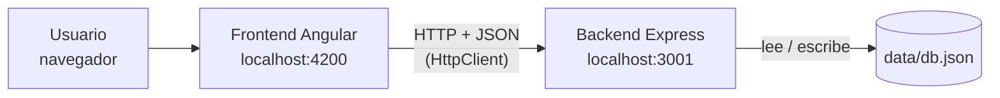
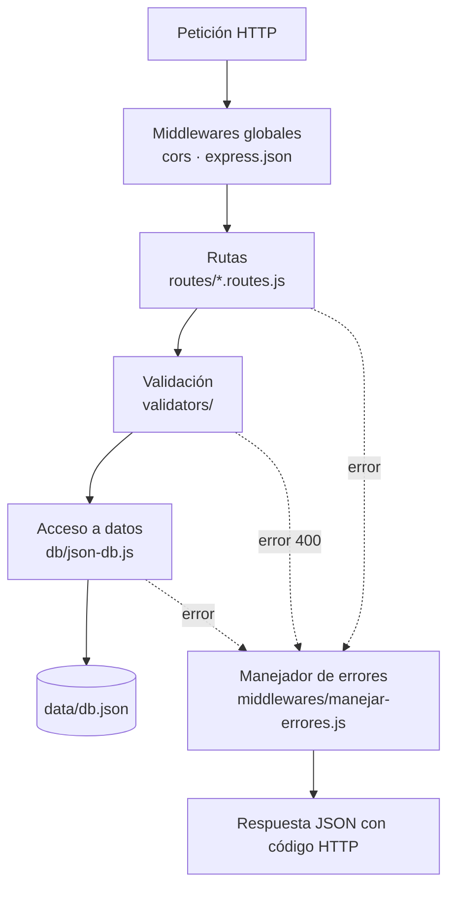
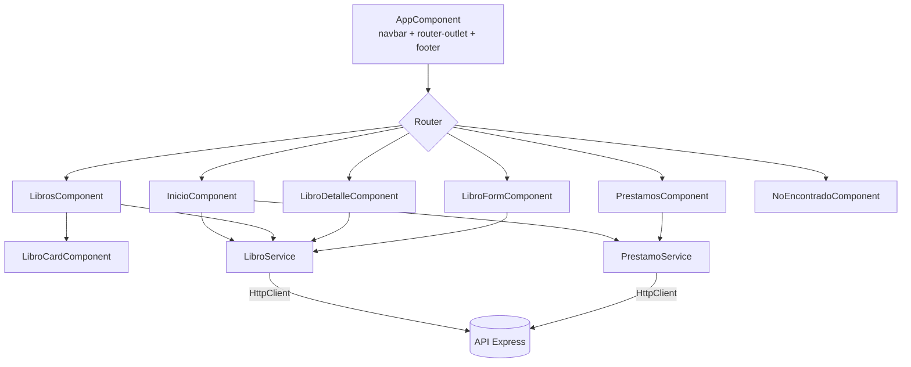
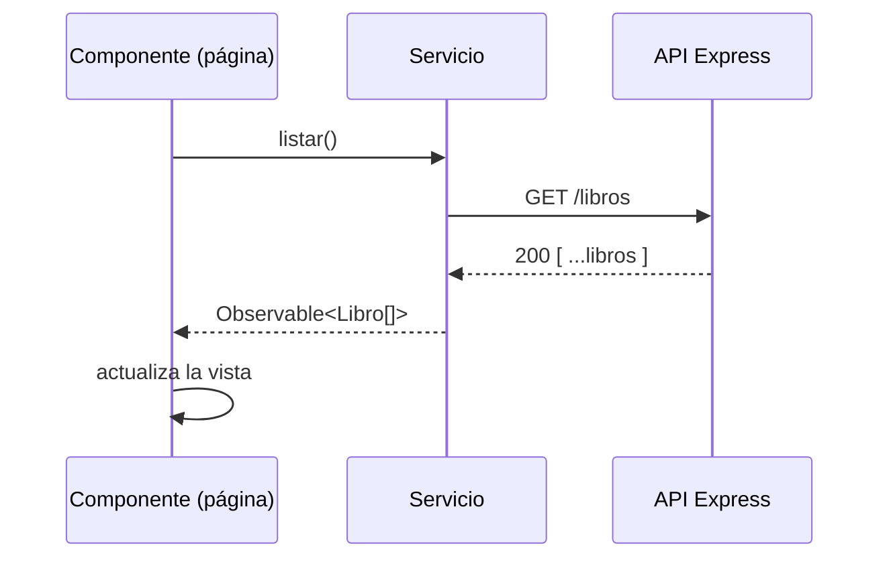

# Arquitectura de BiblioUTP

BiblioUTP es un sistema de gestión de biblioteca: permite administrar el catálogo de libros, sus categorías y los préstamos a lectores.

El proyecto está dividido en dos aplicaciones independientes dentro del mismo repositorio:

| Carpeta | Tecnología | Puerto | Responsabilidad |
|---|---|---|---|
| `frontend/` | Angular 19 + Bootstrap 5 | 4200 | Interfaz de usuario (SPA) |
| `backend/` | Node.js + Express 5 | 3001 | API REST y persistencia en un archivo JSON |

## Vista general



- El frontend es una aplicación de una sola página (SPA): el navegador descarga la app una vez y luego solo intercambia datos JSON con la API.
- El backend no conoce al frontend; expone recursos REST que cualquier cliente puede consumir.
- La comunicación entre ambos está permitida por CORS solo para el origen `http://localhost:4200` (configurable).

## Estructura del repositorio

```text
SEMANA 09/
├── ARQUITECTURA.md          ← este documento
├── backend/
│   ├── data/db.json         ← "base de datos"
│   ├── package.json
│   └── src/
│       ├── server.js        ← punto de entrada (levanta el servidor)
│       ├── app.js           ← configuración de Express y montaje de rutas
│       ├── config.js        ← puerto, ruta del JSON y orígenes CORS
│       ├── db/              ← acceso al archivo JSON
│       ├── routes/          ← rutas REST por recurso
│       ├── validators/      ← esquemas y motor de validación
│       ├── middlewares/     ← manejo de errores y 404
│       └── errors/          ← clase HttpError
└── frontend/
    ├── angular.json
    ├── package.json
    └── src/
        ├── index.html, main.ts, styles.css
        ├── environments/    ← URL de la API
        └── app/
            ├── models/      ← interfaces de datos
            ├── services/    ← comunicación HTTP con la API
            ├── pages/       ← componentes de cada ruta
            ├── components/  ← componentes reutilizables
            ├── directives/  ← directivas personalizadas
            ├── pipes/       ← pipes personalizados
            └── utils/       ← funciones auxiliares
```

---

## Backend

### Capas

El backend sigue una arquitectura por capas sencilla. Cada petición atraviesa las capas de arriba hacia abajo:



| Capa | Archivos | Responsabilidad |
|---|---|---|
| Arranque | `server.js`, `app.js`, `config.js` | Crear la app de Express, registrar middlewares y rutas, leer variables de entorno |
| Rutas | `routes/` | Traducir cada endpoint en una operación sobre una colección |
| Validación | `validators/` | Verificar tipos, formatos y reglas antes de guardar |
| Datos | `db/json-db.js` | Leer y escribir el archivo JSON de forma segura |
| Errores | `errors/`, `middlewares/` | Convertir cualquier fallo en una respuesta JSON coherente |

### Router CRUD genérico

Los tres recursos (libros, categorías y préstamos) comparten las mismas operaciones, así que se generan con una sola función: `crearRouterCrud()` en `routes/crear-router-crud.js`. Cada recurso solo declara lo que lo hace distinto:

```js
export const librosRouter = crearRouterCrud({
  coleccion: 'libros',          // clave dentro de db.json
  recurso: 'Libro',             // nombre usado en los mensajes de error
  esquema: esquemaLibro,        // reglas de validación de campos
  validarReglas: (libro, { db, id }) => { /* unicidad, relaciones */ },
  validarEliminacion: (libro, { db }) => { /* impedir borrar si está en uso */ },
});
```

Así se evita repetir el mismo código en cada archivo de rutas, y agregar un recurso nuevo solo requiere un esquema y, si hace falta, sus reglas propias.

### Endpoints

Cada recurso expone las mismas seis operaciones:

| Método | Ruta | Acción | Respuesta exitosa |
|---|---|---|---|
| `GET` | `/{recurso}` | Listar (admite filtros, ej. `?categoria=Novela`) | `200` + arreglo |
| `GET` | `/{recurso}/:id` | Obtener uno | `200` + objeto |
| `POST` | `/{recurso}` | Crear (el `id` se asigna automáticamente) | `201` + objeto creado |
| `PUT` | `/{recurso}/:id` | Reemplazar completo | `200` + objeto |
| `PATCH` | `/{recurso}/:id` | Actualizar parcialmente | `200` + objeto |
| `DELETE` | `/{recurso}/:id` | Eliminar | `204` sin cuerpo |

Recursos disponibles: `/libros`, `/categorias` y `/prestamos`. Además, `GET /health` responde `{ "estado": "ok" }` para comprobar que la API está activa.

### Validación

La validación ocurre en dos niveles:

1. **Por campo** (`validators/esquemas.js` + `validators/validar.js`): cada recurso tiene un esquema que define tipo, obligatoriedad, rangos y formatos. Las reglas replican las del formulario de Angular, para que la API no dependa de que el cliente valide bien. Los campos que no están en el esquema se descartan.
2. **Reglas de negocio** (`validarReglas` y `validarEliminacion` de cada ruta): dependen de otros datos de la base.

| Recurso | Reglas de negocio |
|---|---|
| Libros | La categoría debe existir · el ISBN no puede repetirse · no se puede eliminar un libro con préstamos activos |
| Categorías | El nombre no puede repetirse · no se puede eliminar ni renombrar una categoría que tiene libros |
| Préstamos | El libro debe existir · la fecha de devolución no puede ser anterior a la del préstamo |

### Persistencia en JSON

`data/db.json` contiene un objeto con tres colecciones: `libros`, `categorias` y `prestamos`. El módulo `db/json-db.js` ofrece dos operaciones:

- `obtenerColeccion(nombre)`: lectura.
- `modificar(nombre, mutacion)`: lee el archivo, aplica el cambio y lo vuelve a escribir.

Las escrituras se **encolan** (se ejecutan una detrás de otra). Sin esa cola, dos peticiones simultáneas podrían leer el mismo estado y la segunda borraría los cambios de la primera. Si la mutación lanza un error (por ejemplo, una regla de negocio no se cumple), el archivo no se modifica.

### Manejo de errores

Todos los errores terminan en `middlewares/manejar-errores.js` y se devuelven con el mismo formato:

```json
{
  "error": "Datos inválidos",
  "detalles": { "isbn": "Formato esperado: 978-XXXXXXXXXX" }
}
```

| Código | Cuándo ocurre |
|---|---|
| `400` | JSON mal formado, id no numérico o datos que no pasan la validación |
| `404` | El registro o la ruta no existen |
| `409` | Conflicto con otros datos (ISBN duplicado, libro con préstamos activos, etc.) |
| `500` | Error inesperado del servidor |

### Configuración

| Variable de entorno | Valor por defecto | Uso |
|---|---|---|
| `PORT` | `3001` | Puerto de la API |
| `DB_PATH` | `backend/data/db.json` | Archivo usado como base de datos |
| `CORS_ORIGINS` | `http://localhost:4200` | Orígenes permitidos, separados por coma |

---

## Frontend

### Organización

El frontend usa **componentes standalone** de Angular (sin `NgModule`). Cada pieza declara en su propio `imports` lo que necesita.



| Carpeta | Contenido | Responsabilidad |
|---|---|---|
| `models/` | `Libro`, `Categoria`, `Prestamo` | Interfaces TypeScript que describen los datos de la API |
| `services/` | `LibroService`, `PrestamoService` | Únicos lugares que hacen peticiones HTTP; devuelven `Observable` |
| `pages/` | Un componente por ruta | Cargan datos con los servicios y manejan la interacción de cada pantalla |
| `components/` | `NavbarComponent`, `FooterComponent`, `LibroCardComponent` | Piezas visuales reutilizables |
| `directives/` | `appResaltar`, `appEstadoStock`, `*appRepetir` | Comportamiento reutilizable aplicado a elementos HTML |
| `pipes/` | `filtrarLibros`, `truncar`, `diasRestantes` | Transformaciones de datos para mostrar en las plantillas |
| `utils/` | `portada.ts` | Detección de portadas inexistentes y portada por defecto |

### Rutas

Definidas en `app.routes.ts`. Gracias a `withComponentInputBinding()`, los parámetros de la URL llegan directamente como `@Input()` del componente (por ejemplo `id` en el detalle, o `?libro=3` en préstamos).

| Ruta | Componente | Descripción |
|---|---|---|
| `/` | `InicioComponent` | Resumen con indicadores, novedades y accesos rápidos |
| `/libros` | `LibrosComponent` | Catálogo con búsqueda y filtro por categoría |
| `/libros/nuevo` | `LibroFormComponent` | Registrar un libro |
| `/libros/:id` | `LibroDetalleComponent` | Ficha completa de un libro |
| `/libros/:id/editar` | `LibroFormComponent` | Editar un libro (mismo componente, modo edición) |
| `/prestamos` | `PrestamosComponent` | Registrar préstamos, devolverlos y ver el historial |
| `**` | `NoEncontradoComponent` | Página 404 |

### Flujo de datos

Los componentes nunca llaman a `HttpClient` directamente: siempre pasan por un servicio. La URL base de la API se toma de `environments/environment.ts`.



Ejemplo con más de un paso: al **registrar un préstamo**, `PrestamosComponent` primero crea el préstamo (`POST /prestamos`) y, cuando termina, descuenta un ejemplar del libro (`PATCH /libros/:id` con el nuevo `stock`). Al **devolverlo**, marca el préstamo como devuelto y suma el ejemplar. Estas operaciones se encadenan con el operador `switchMap` de RxJS.

### Formularios

El proyecto usa los dos enfoques de formularios de Angular:

| Pantalla | Enfoque | Detalles |
|---|---|---|
| Nuevo / editar libro | **Reactivo** (`FormBuilder`) | Validadores en el código, incluido uno personalizado que impide años futuros; vista previa en vivo de la tarjeta |
| Préstamos | **Basado en plantilla** (`ngModel`) | Validación declarada en el HTML (`required`, `email`, `minlength`) |

### Directivas y pipes personalizados

| Nombre | Tipo | Qué hace |
|---|---|---|
| `appResaltar` | Directiva de atributo | Eleva el elemento y le agrega sombra al pasar el mouse |
| `appEstadoStock` | Directiva de atributo | Colorea un chip según el stock: verde, ámbar (≤ 2) o rojo (agotado) |
| `*appRepetir` | Directiva estructural | Repite una plantilla N veces (usada para el esqueleto de carga) |
| `filtrarLibros` | Pipe | Filtra por texto (título o autor) y categoría |
| `truncar` | Pipe | Corta textos largos y agrega `...` |
| `diasRestantes` | Pipe | Convierte una fecha en "Faltan 3 días", "Vence hoy" o "Vencido hace 2 días" |

### Estilos

- **Bootstrap 5** y **Bootstrap Icons** se cargan desde `angular.json`.
- `src/styles.css` define el tema propio (colores, tipografías Fraunces e Inter, tarjetas, chips, tablas) sobrescribiendo las variables CSS de Bootstrap, sin necesidad de recompilarlo.
- La configuración regional es `es-PE` (`app.config.ts`), por lo que fechas y montos en soles se muestran en formato peruano.

---

## Cómo ejecutar el proyecto

Requisito: Node.js 20 o superior.

```bash
# Solo la primera vez
cd backend && npm install
cd ../frontend && npm install

# Levantar backend y frontend juntos (desde frontend/)
npm run dev
```

También se pueden levantar por separado:

```bash
# Terminal 1
cd backend
npm run dev     # API en http://localhost:3001 (se reinicia al guardar cambios)

# Terminal 2
cd frontend
npm start       # App en http://localhost:4200
```
