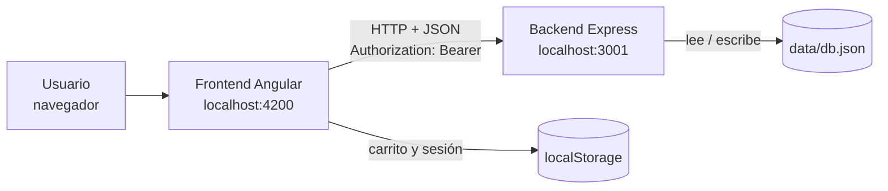
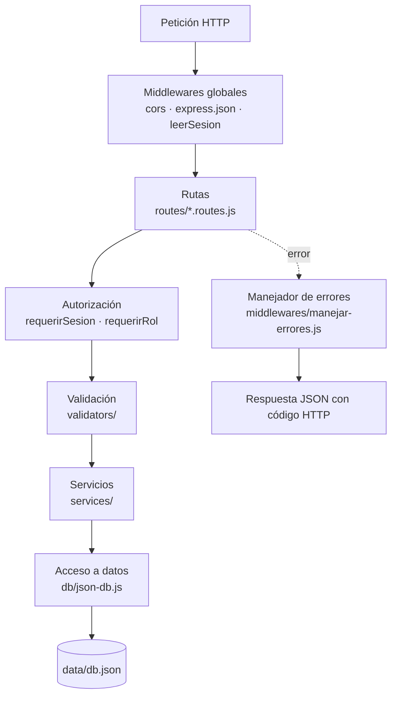
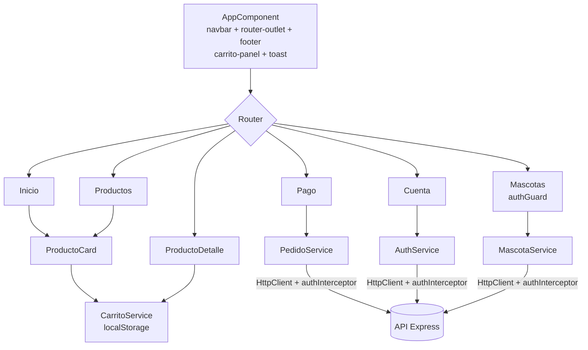

# Arquitectura de DancyPet

DancyPet es una tienda en línea para mascotas: catálogo de productos por categoría, carrito de compras, pago simulado, cuentas de usuario y registro de mascotas con una suscripción mensual de alimento.

El diseño, las imágenes y el dominio provienen del proyecto de la **Semana 05** (HTML + CSS + JavaScript puro). En esta semana se reconstruyó con la arquitectura de la **Semana 09**: una SPA en Angular que consume una API REST en Express.

El proyecto está dividido en dos aplicaciones independientes dentro del mismo repositorio:

| Carpeta | Tecnología | Puerto | Responsabilidad |
|---|---|---|---|
| `frontend/` | Angular 19 (standalone + signals) | 4200 | Interfaz de usuario (SPA) |
| `backend/` | Node.js 22 + Express 5 | 3001 | API REST, autenticación y persistencia en un archivo JSON |

## Vista general



- El catálogo, los usuarios, las mascotas y los pedidos viven en la API.
- El **carrito** se guarda solo en el navegador (`localStorage`), igual que en la Semana 05. Al pagar, el frontend envía únicamente `productoId` y `cantidad`: **el servidor recalcula precios y totales**, así que manipular el carrito no cambia lo que se cobra.
- La comunicación entre ambos está permitida por CORS solo para `http://localhost:4200` (configurable).

## Estructura del repositorio

```text
SEMANA 09/
├── README.md                  ← este documento
├── backend/
│   ├── .env.example           ← variables de entorno (copiar como .env)
│   ├── data/db.json           ← "base de datos"
│   └── src/
│       ├── server.js          ← punto de entrada
│       ├── app.js             ← middlewares globales y montaje de rutas
│       ├── config.js          ← puerto, ruta del JSON, CORS y clave de tokens
│       ├── db/                ← acceso al archivo JSON (cola de escrituras)
│       ├── routes/            ← rutas REST por recurso
│       ├── services/          ← lógica de negocio (pagos, pedidos, suscripción, seguridad)
│       ├── validators/        ← esquemas y motor de validación
│       ├── middlewares/       ← autenticación, errores y 404
│       └── errors/            ← clase HttpError
└── frontend/
    ├── public/imagenes/       ← logo y fotos de productos (de la Semana 05)
    └── src/
        ├── index.html, main.ts, styles.css
        ├── environments/      ← URL de la API
        └── app/
            ├── models/        ← interfaces de datos
            ├── services/      ← HTTP y estado compartido (signals)
            ├── interceptors/  ← agrega el token a cada petición
            ├── guards/        ← protege rutas que requieren sesión
            ├── pages/         ← componentes de cada ruta
            ├── components/    ← componentes reutilizables
            ├── directives/    ← directivas personalizadas
            ├── pipes/         ← pipes personalizados
            └── utils/         ← funciones auxiliares
```

---

## Backend

### Capas



| Capa | Archivos | Responsabilidad |
|---|---|---|
| Arranque | `server.js`, `app.js`, `config.js` | Crear la app, registrar middlewares y rutas, leer variables de entorno |
| Rutas | `routes/` | Traducir cada endpoint en una operación |
| Autenticación | `middlewares/autenticar.js`, `services/seguridad.js` | Hash de contraseñas, emisión y verificación de tokens, control por rol |
| Servicios | `services/` | Reglas de negocio: validar pagos, armar pedidos, calcular la suscripción |
| Validación | `validators/` | Verificar tipos, formatos y rangos antes de guardar |
| Datos | `db/json-db.js` | Leer y escribir el archivo JSON de forma segura |
| Errores | `errors/`, `middlewares/` | Convertir cualquier fallo en una respuesta JSON coherente |

### Endpoints

| Método | Ruta | Acceso | Descripción |
|---|---|---|---|
| `GET` | `/health` | Público | Comprueba que la API está activa |
| `POST` | `/auth/registro` | Público | Crea una cuenta y devuelve `{ token, usuario }` |
| `POST` | `/auth/login` | Público | Inicia sesión y devuelve `{ token, usuario }` |
| `GET` | `/auth/perfil` | Sesión | Datos del usuario autenticado |
| `GET` | `/categorias`, `/productos` | Público | Listar (admite filtros, ej. `?categoria=perros`) |
| `GET` | `/categorias/:id`, `/productos/:id` | Público | Obtener uno |
| `POST` `PUT` `PATCH` `DELETE` | `/categorias`, `/productos` | Admin | Mantenimiento del catálogo |
| `GET` `POST` `PUT` `PATCH` `DELETE` | `/mascotas` | Sesión | CRUD de las mascotas **del usuario autenticado** |
| `GET` | `/pedidos` | Sesión | Pedidos del usuario, del más reciente al más antiguo |
| `POST` | `/pedidos` | Público / Sesión | Registrar una compra o una suscripción (ver abajo) |

#### Pedidos

`POST /pedidos` acepta dos tipos de pedido:

```jsonc
// Compra del carrito (se permite como invitado)
{ "tipo": "compra", "items": [{ "productoId": 2, "cantidad": 2 }], "pago": { "metodo": "tarjeta", ... } }

// Suscripción mensual (requiere sesión y pago con tarjeta)
{ "tipo": "suscripcion", "mascotaId": 1, "entrega": { "direccion": "...", "horario": "11:00 - 14:00" }, "pago": { ... } }
```

- **Precios:** el servidor toma el precio de cada producto desde la base, calcula subtotal, IGV (18 %) y total. Los productos no disponibles se rechazan.
- **Pago simulado:** se aceptan `tarjeta` (número validado con el algoritmo de Luhn y fecha de vencimiento futura), `yape` (celular de 9 dígitos que empieza en 9) y `efectivo`. De la tarjeta solo se guardan la marca y los **últimos 4 dígitos**; el número completo y el CVV nunca se almacenan.
- **Suscripción:** el monto se calcula con `services/suscripcion.js` según tipo, edad, peso y tipo de comida de la mascota. La mascota se marca como suscrita en la **misma transacción** que registra el pedido, de modo que no puede quedar activa sin pago. Una mascota con suscripción activa no se puede volver a suscribir (`409`) ni eliminar.
- **Número de pedido:** se genera con `BigInt` a partir del id (`1000001`, `1000002`, ...).

### Autenticación

1. Las contraseñas se guardan con **scrypt** y una sal aleatoria (`salt:hash`); nunca en texto plano.
2. Al registrarse o iniciar sesión, la API firma un token con **HMAC-SHA256** que contiene el id, el rol y la fecha de expiración (7 días por defecto).
3. El frontend envía el token en `Authorization: Bearer <token>` mediante un interceptor.
4. `leerSesion` lo verifica en cada petición. Si el token es inválido o expiró, la petición sigue como invitado (las rutas públicas funcionan) y las rutas protegidas responden `401 La sesión expiró`.

Los usuarios nuevos tienen rol `cliente`. Para crear un **administrador**, registra la cuenta normalmente y cambia su `"rol"` a `"admin"` en `backend/data/db.json`.

### Persistencia en JSON

`data/db.json` contiene las colecciones `categorias`, `productos`, `usuarios`, `mascotas` y `pedidos`. El módulo `db/json-db.js` ofrece:

- `obtenerColeccion(nombre)`: lectura.
- `modificar(nombre, mutacion)`: cambia una colección.
- `transaccion(mutacion)`: cambia varias colecciones a la vez (por ejemplo, pedido + mascota).

Las escrituras se **encolan** para que dos peticiones simultáneas no se pisen. Si la mutación lanza un error, el archivo no se modifica.

### Manejo de errores

Todos los errores se devuelven con el mismo formato:

```json
{
  "error": "Datos inválidos",
  "detalles": { "pago.numero": "Número de tarjeta inválido" }
}
```

| Código | Cuándo ocurre |
|---|---|
| `400` | JSON mal formado, id no numérico o datos que no pasan la validación |
| `401` | Falta iniciar sesión, credenciales incorrectas o sesión expirada |
| `403` | La sesión no tiene el rol necesario (por ejemplo, escribir en el catálogo sin ser admin) |
| `404` | El registro o la ruta no existen (incluye mascotas de otro usuario) |
| `409` | Conflicto con otros datos (correo ya registrado, categoría con productos, suscripción ya activa, etc.) |
| `413` | El cuerpo supera 2 MB (por ejemplo, una foto demasiado grande) |
| `500` | Error inesperado del servidor |

### Configuración

Copia `backend/.env.example` como `backend/.env`. El archivo `.env` está en `.gitignore`.

| Variable | Valor por defecto | Uso |
|---|---|---|
| `PORT` | `3001` | Puerto de la API |
| `DB_PATH` | `backend/data/db.json` | Archivo usado como base de datos |
| `CORS_ORIGINS` | `http://localhost:4200` | Orígenes permitidos, separados por coma |
| `TOKEN_SECRET` | aleatoria en cada arranque | Clave para firmar los tokens. Sin ella, las sesiones se pierden al reiniciar la API |
| `TOKEN_DURACION_HORAS` | `168` | Vigencia del token |

---

## Frontend

### Organización



| Carpeta | Contenido |
|---|---|
| `models/` | `Producto`, `Categoria`, `ItemCarrito`, `Usuario`, `Sesion`, `Mascota`, `Suscripcion`, `Pedido`, `Pago` |
| `services/` | `ProductoService`, `CarritoService`, `AuthService`, `MascotaService`, `PedidoService`, `ToastService` |
| `interceptors/` | `authInterceptor`: agrega el token y cierra la sesión si la API responde `401` |
| `guards/` | `authGuard`: redirige a `/cuenta?volver=...` si no hay sesión |
| `components/` | `Navbar`, `Footer`, `CarritoPanel`, `ProductoCard`, `Toast` |
| `directives/` | `appResaltar`, `appBadgeProducto`, `*appRepetir` |
| `pipes/` | `soles`, `filtrarProductos`, `truncar` |
| `utils/` | Imagen de respaldo, validación y formato de tarjetas, mensajes de error de la API |

### Rutas

Gracias a `withComponentInputBinding()`, los parámetros de la URL llegan como `@Input()` (por ejemplo `id` en el detalle, `?categoria=gatos` en el catálogo o `?suscripcion=1` en el pago).

| Ruta | Componente | Descripción |
|---|---|---|
| `/` | `InicioComponent` | Hero, categorías, productos destacados, beneficios, nosotros y newsletter |
| `/productos` | `ProductosComponent` | Catálogo con filtro por categoría, búsqueda y orden |
| `/productos/:id` | `ProductoDetalleComponent` | Ficha del producto, selector de cantidad y "Comprar ahora" |
| `/pago` | `PagoComponent` | Pago del carrito (tarjeta, Yape/Plin o contra entrega) |
| `/pago?suscripcion=:id` | `PagoComponent` | Pago de la suscripción de una mascota (solo tarjeta) |
| `/cuenta` | `CuentaComponent` | Iniciar sesión / crear cuenta; con sesión, perfil y "Mis pedidos" |
| `/cuenta/mascotas` | `MascotasComponent` | Registrar, editar y eliminar mascotas; iniciar la suscripción |
| `**` | `NoEncontradoComponent` | Página 404 |

### Estado compartido con signals

`CarritoService` y `AuthService` exponen su estado con **signals** (`signal`, `computed`, `effect`), así el contador del navbar, el panel del carrito y la página de pago se actualizan solos:

- `CarritoService`: ítems, cantidad total, subtotal, IGV y total. Persiste en `localStorage` (`dancypet-cart`).
- `AuthService`: sesión actual. Con "Recordarme" se guarda en `localStorage`; sin esa opción, en `sessionStorage`.

### Formularios

| Pantalla | Enfoque | Detalles |
|---|---|---|
| Mascotas | **Reactivo** (`FormBuilder`) | Rangos de edad y peso, foto opcional convertida a data URL (máx. 1 MB), modo edición |
| Login / registro | **Plantilla** (`ngModel`) | Correo válido, contraseña de al menos 6 caracteres, confirmación de contraseña y términos |
| Pago | **Plantilla** (`ngModel`) | Número de tarjeta y vencimiento con formato automático; validación Luhn antes de enviar |
| Suscripción y newsletter | **Plantilla** (`ngModel`) | Dirección, horario de entrega y correo |

### Estilos

- `src/styles.css` es la hoja de estilos de la Semana 05 (variables de color, tipografías Fraunces y DM Sans, tarjetas, carrito lateral, modal y toast), ampliada al final con las vistas nuevas: detalle de producto, pago, cuenta, mascotas y estados de carga.
- Se retiró Bootstrap porque sus clases (`.btn`, `.modal`, `.toast`, `.container`) chocaban con las del diseño original.
- La configuración regional es `es-PE`, por lo que fechas y montos se muestran en formato peruano.

---

## Cómo ejecutar el proyecto

Requisito: **Node.js 22.9 o superior** (la API usa `--env-file-if-exists`).

```bash
# Solo la primera vez
cd backend
npm install
copy .env.example .env      # y reemplaza TOKEN_SECRET por una clave aleatoria
cd ../frontend
npm install

# Levantar backend y frontend juntos (desde frontend/)
npm run dev
```

También se pueden levantar por separado:

```bash
# Terminal 1
cd backend
npm run dev     # API en http://localhost:3001 (se reinicia al guardar cambios)

# Terminal 2
cd frontend
npm start       # App en http://localhost:4200
```

Tarjeta de prueba para los pagos: `4111 1111 1111 1111`, cualquier fecha futura y CVV `123`.
